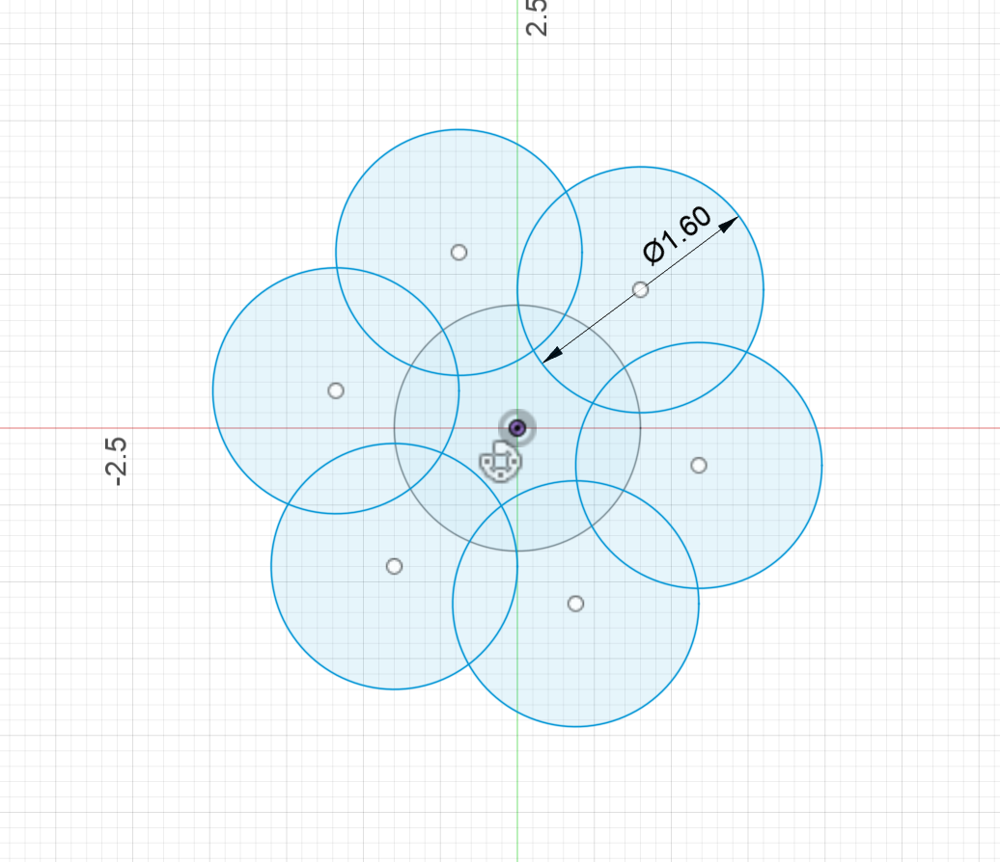
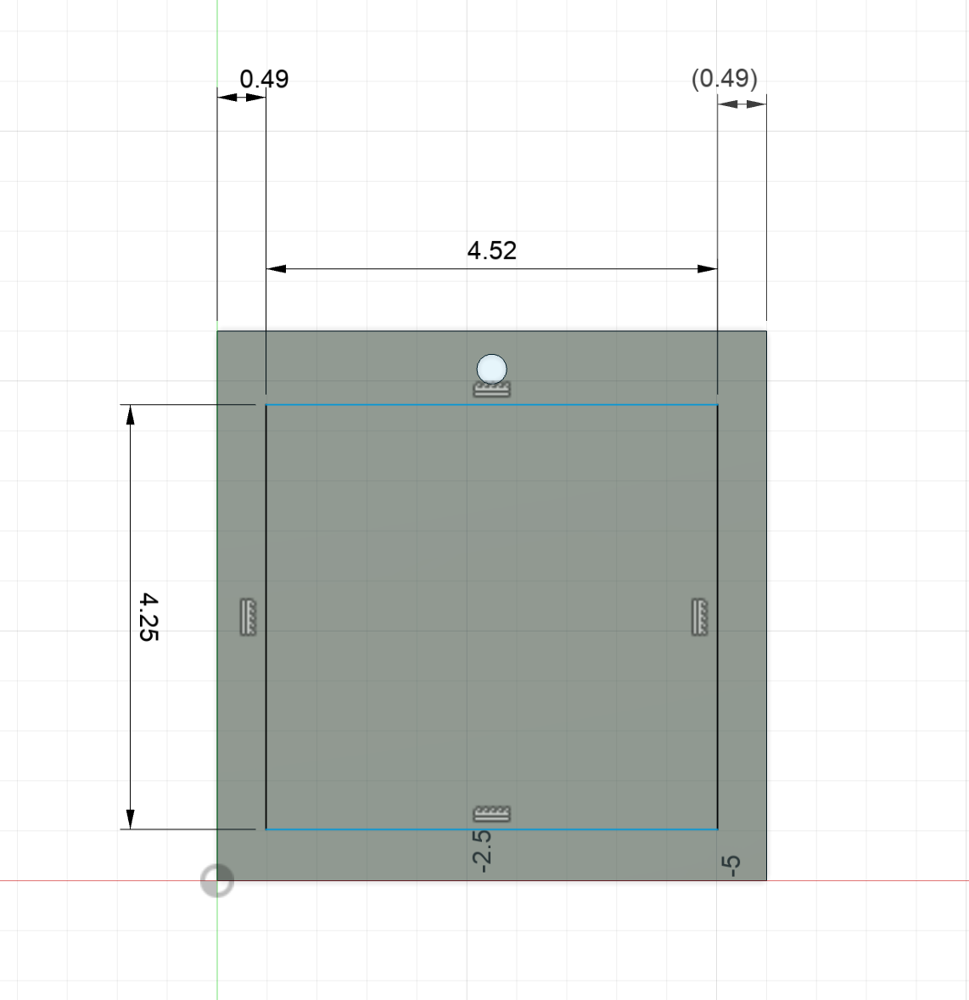
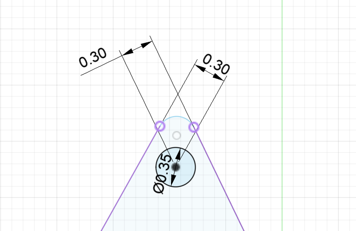
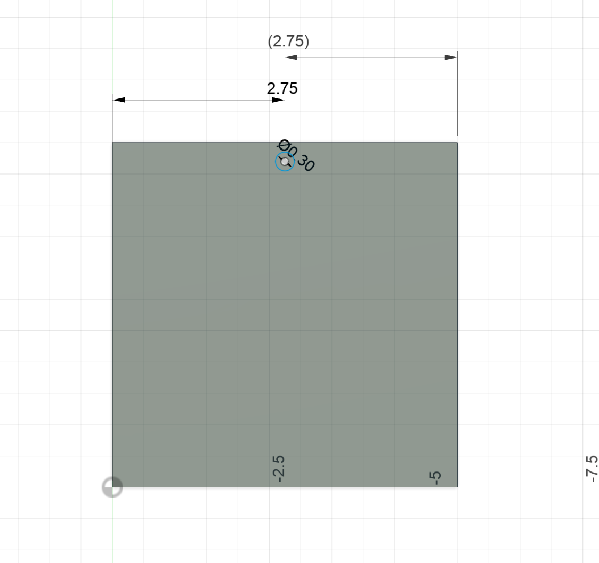
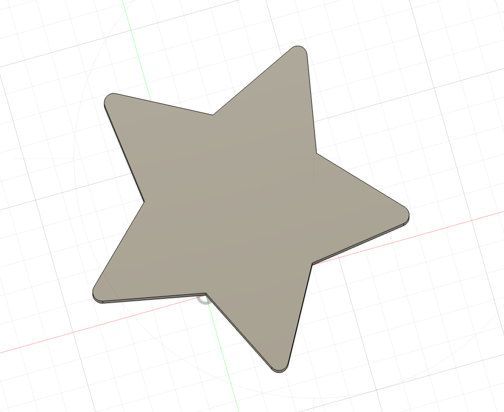

# Project: Cassette

## About: It's a little collection of charms - a flower, a album player and a star
I'm planning to use them maybe as a cluster by adding more bunches after they get 3d printed or group them together, we'll see :3

## Designs!!

| Charm | image | with appearance added |
|---|---|---|
| flower |  | |
| star |  |  |
| album | |  |

## Repo

``` 
cassette/
|- CAD files
|- images
|- README.md
```

## Tools used
- Fusion 360 (Personal Use) - CAD
- Pinterest - for inspiration

<br>
